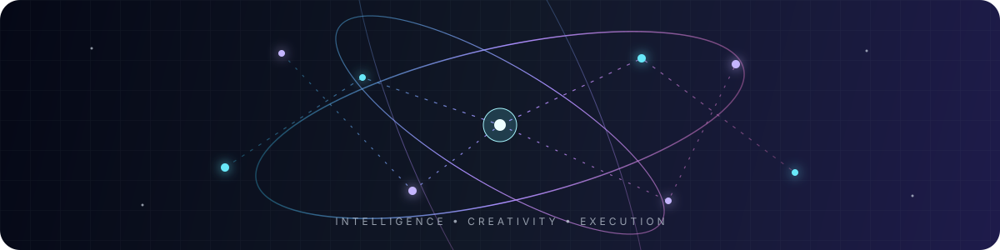

<h2>⚡ Building intelligent systems for a better digital future</h2>

  <strong>Machine Learning</strong> · <strong>Computer Vision</strong> · <strong>Full-Stack Development</strong>

  
  
  

<code>STATUS: OPEN TO AI/ML & DATA ANALYTICS OPPORTUNITIES</code> 🚀

### `01` — SUMMARY

> I’m Shivam Jain, a Computer Science student and AI/ML engineer who enjoys turning complex ideas into useful, human-centered products. I work across intelligent systems, computer vision, APIs, data, and polished interfaces. I previously worked as an AI/ML Intern at AeroSearch, where I built object detection systems using RGB and thermal sensor fusion.

Open to coffee chats, collaborations, internships, and ambitious ideas. Feel free to connect and start a conversation.

| 🎓 **Education** | 📈 **CGPA** | 🧠 **Focus** | 🏆 **Highlight** |
|:---:|:---:|:---:|:---:|
| Bennett University | 8.13 | AI/ML + Data | NCC Best Cadet Gold Medalist |

## `02` — SYSTEM CAPABILITIES

<table>
  <tr>
    <td align="center" width="25%"><h3>🧠</h3><strong>Applied AI</strong> Models that solve real problems</td>
    <td align="center" width="25%"><h3>👁️</h3><strong>Vision Systems</strong> Detection, fusion & explainability</td>
    <td align="center" width="25%"><h3>🌐</h3><strong>Product Engineering</strong> Interfaces, APIs & platforms</td>
    <td align="center" width="25%"><h3>📊</h3><strong>Data Intelligence</strong> Insights, dashboards & analytics</td>
  </tr>
</table>

## `03` — NEON TECH MATRIX

<em>My toolkit for designing, training, shipping, and improving intelligent products.</em>

<table>
  <tr>
    <td align="center" width="50%">
      <h3>◈ FRONTEND</h3>
       
      
    </td>
    <td align="center" width="50%">
      <h3>◈ BACKEND</h3>
       
      
    </td>
  </tr>
  <tr>
    <td align="center" width="50%">
      <h3>◈ DATA LAYER</h3>
      
    </td>
    <td align="center" width="50%">
      <h3>◈ DEVOPS TOOLKIT</h3>
      
    </td>
  </tr>
  <tr>
    <td align="center" colspan="2">
      <h3>◈ MACHINE LEARNING / AI</h3>
      
    </td>
  </tr>
</table>

<code>DESIGN</code> <code>DEVELOP</code> <code>TRAIN</code> <code>DEPLOY</code> <code>ITERATE</code>

## `04` — FEATURED BUILDS

### 🫁 [Caryaai](https://caryaai.streamlit.app) · Thoracic Disease Detection
> Deep learning system for detecting and classifying **14 thoracic diseases** from chest X-rays.

`PyTorch` `TensorFlow` `OpenCV` `Grad-CAM` `Streamlit`

### 😶 EmotionI · Multimodal Emotion Recognition
> AI system combining **facial expressions, speech, and text** to understand human emotion.

`Python` `Flask` `OpenCV` `TensorFlow` `NLTK` `JavaScript`

### 🔐 Security Analytics Authentication
> Intelligent authentication using **IP geolocation, device fingerprinting, risk scoring, and behavioural analytics**.

`Python` `Flask` `SQL` `Google Maps API` `MaxMind GeoIP`

### 🧘 Project Serenity · Smart India Hackathon
> AI-powered mental wellness experience with sentiment analysis, mood tracking, and mindfulness support.

`Python` `TensorFlow` `NLTK` `Flask` `JavaScript`
